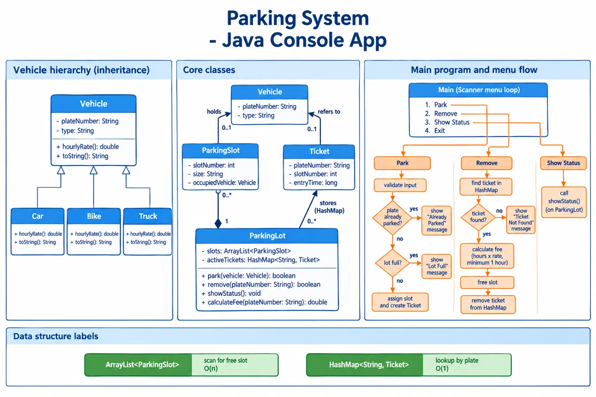

# Parking System (Java Console App)

A console-based parking lot manager built with core Java and OOP.
Vehicles park in free slots, receive a ticket, and are removed by plate number.

## Features
- Park a vehicle in the first free slot
- Reject duplicate plates and a full lot
- Remove a vehicle by plate number (case and space insensitive)
- Show the status of every slot
- Fee calculation: hours rounded up, minimum 1 hour (Wed)
- Console menu with input validation (Wed)

## Concepts used
Abstraction (abstract class), inheritance, method overriding,
encapsulation (private final fields), ArrayList, HashMap.

## Class design


| Class | Role |
|---|---|
| `Vehicle` (abstract) | Holds the plate; each child defines `hourlyRate()` |
| `Car`, `Bike`, `Truck` | Rates 20, 10 and 50 per hour |
| `ParkingSlot` | One space; holds at most one vehicle |
| `Ticket` | Plate, slot number, entry time |
| `ParkingLot` | Manages slots and tickets: park, remove, showStatus |
| `Main` | Menu loop (Wed) |

## How to run
```bash
cd "Parking system"
javac *.java
java Main
```

## Sample output
(paste real console output here)

## Design decisions
- Tickets are keyed by plate number, so there is no separate ticket ID.
- Plates are trimmed and upper-cased in `Vehicle`, so `gj01pc4751`
  and `GJ01PC4751` are the same vehicle.
- Any vehicle fits any slot (all slots are MEDIUM).
- The fee is calculated before the slot is freed, because the vehicle
  is needed for its rate.

## Complexity
| Operation | Time |
|---|---|
| park | O(n) free-slot scan, O(1) duplicate check |
| remove | O(1) average |
| showStatus | O(n) |

## Possible improvements
- Slot sizes (a Truck needs a large slot)
- A Truck needing 2 consecutive free slots
- Saving tickets to a file